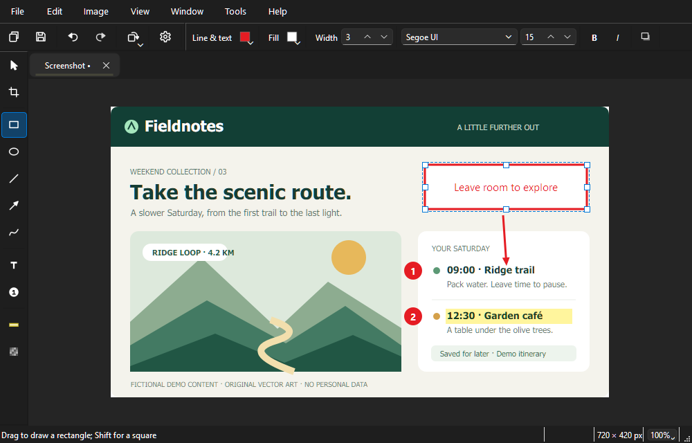
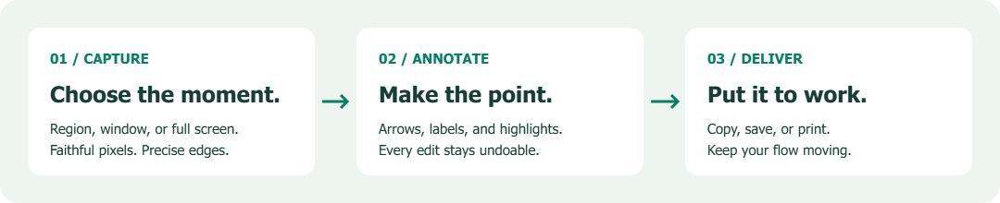
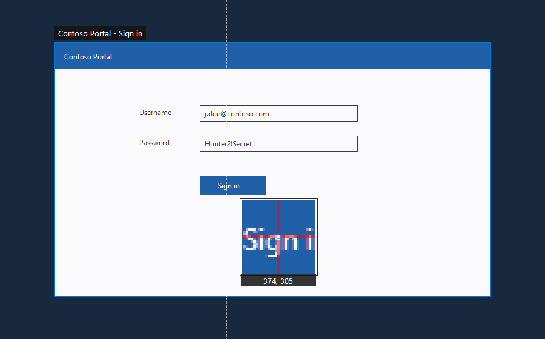
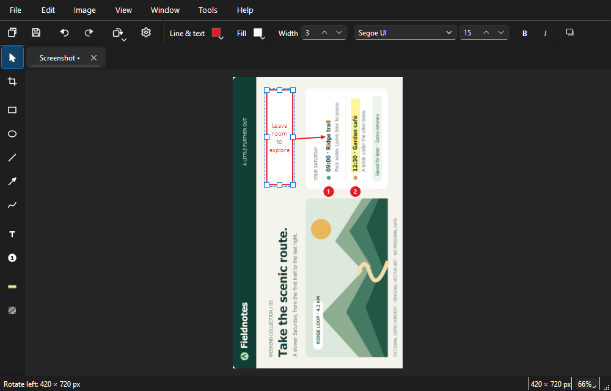
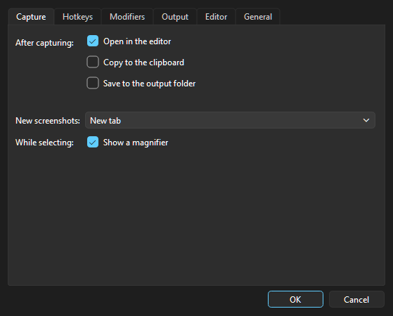
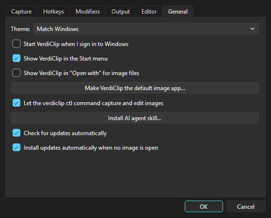

# VerdiClip

<picture>
  <source media="(prefers-color-scheme: dark)" srcset="https://raw.githubusercontent.com/mikejhill/verdiclip/main/docs/brand/wordmark-dark.png">
  <source media="(prefers-color-scheme: light)" srcset="https://raw.githubusercontent.com/mikejhill/verdiclip/main/docs/brand/wordmark-light.png">
  
</picture>

[](https://github.com/mikejhill/verdiclip/actions/workflows/ci.yml)
[](https://pypi.org/project/verdiclip/)
[](https://pypi.org/project/verdiclip/)
[](https://github.com/mikejhill/verdiclip/blob/main/LICENSE)

Fast, faithful screenshots for Windows: grab a precise piece of the screen, mark it up, and put it where it needs to go — in seconds.



VerdiClip is an independent project. See [ATTRIBUTION.md](https://github.com/mikejhill/verdiclip/blob/main/ATTRIBUTION.md) for credits.



## Install

Requires Windows 10 or later and Python 3.13+.

```bash
uv tool install verdiclip
```

Or with pip: `pip install verdiclip`. Then run `verdiclip` (or `verdiclip-gui` for no console window) and VerdiClip sits in the system tray.

### Updates

VerdiClip checks PyPI for a newer release a minute after it starts and every 6 hours after that. When it finds one and no image is open, it quits, installs the release, and starts again. A tray notification then says what changed. It updates the way you installed it:

| Installed with | Update |
| --- | --- |
| `uv tool install verdiclip` | `uv tool upgrade verdiclip` |
| `pip install verdiclip` (or `uv pip`) | Upgrade in that environment |
| `uvx verdiclip` | Fetch the release with `uvx`, then restart with it (the old version if that fails) |
| A git checkout (`uv sync`) | `git pull --ff-only` and `uv sync`, only on `main` with no local changes |

Tray → **Check for updates** opens a status window immediately. It stays visible with the result or an error; a failed check can be retried. Development versions that cannot be compared with stable releases say so explicitly. Settings → General turns off automatic checking, or automatic installing (VerdiClip then offers each release in a notification). If an update fails, the old version starts again and the notification names the log, `%APPDATA%\VerdiClip\update\update.log`.

## Capture and tabs

Completed captures open a new tab in the existing editor by default; Settings can choose separate windows. The editor is brought forward when capture completes, unless protected editor UI is open. Ordinary region, window, full-screen and Repeat capture keep their existing behavior. Scrolling capture is a separate command (see below).

## Capture

| Do this | Press |
| --- | --- |
| Drag a region, or click a window | `PrtSc` (or left-click the tray icon) |
| Capture the active window | `Alt+PrtSc` |
| Capture every monitor | `Ctrl+PrtSc` |
| Repeat the last capture | `Shift+PrtSc` |
| Capture a scrolling area | `Ctrl+Alt+PrtSc` |



While selecting, the screen is frozen so you get exactly what you saw. A magnifier follows the cursor, arrow keys nudge it by a pixel (`Ctrl` for 10), `Enter` starts and finishes a selection from the keyboard, clicking without dragging captures the window under the cursor, and `Esc` cancels.

If Windows or another screenshot tool already owns `PrtSc`, VerdiClip tells you which hotkeys are taken; everything is still available from the tray menu, and you can choose other keys in Settings.

### Scrolling capture

Choose **Capture scrolling area** from the tray, or press `Ctrl+Alt+PrtSc`, then click inside the panel you want (a web page, a document, a list). You can also start it from an ordinary region capture (`PrtSc`): hold `Ctrl` and click the panel. VerdiClip scrolls it to the top, captures it page by page to the bottom, joins the pages, and puts the panel back where it was. The image uses your usual editor, clipboard and file settings. Press `Esc` to stop.

It works with panels that support Windows UI Automation scrolling, which covers browsers, Office, Explorer and most modern apps. Sticky headers and footers appear once. If some pages could not be matched exactly, the image is still delivered and VerdiClip tells you to check it. Keep other windows off the panel while it runs.

## Annotate

| Tool | Key | Tool | Key |
| --- | --- | --- | --- |
| Select | `V` | Text | `T` |
| Crop | `C` | Counter | `N` |
| Rectangle | `R` | Highlight | `H` |
| Ellipse | `E` | Obfuscate | `O` |
| Line | `L` | Freehand | `F` |
| Arrow | `A` | | |

| Action | Shortcut |
| --- | --- |
| Copy image and close | `Ctrl+Shift+C` |
| Save / Save as | `Ctrl+S` / `Ctrl+Shift+S` |
| Undo / Redo | `Ctrl+Z` / `Ctrl+Y` |
| Copy / Paste marks | `Ctrl+C` / `Ctrl+V` |
| Delete selection | `Delete` |
| Print | `Ctrl+P` |
| Previous / next tab | `Ctrl+PgUp` / `Ctrl+PgDown` (also `Ctrl+Shift+Tab` / `Ctrl+Tab`) |
| Move tab left / right | `Ctrl+Shift+PgUp` / `Ctrl+Shift+PgDown` |
| Zoom | `Ctrl+wheel` |
| Actual size / Fit | `Ctrl+0` / `Ctrl+Shift+F` |
| Pan | `Space`+drag |
| Nudge / Nudge faster | Arrows / `Ctrl`+Arrows |
| Rotate right / left | `Ctrl+R` / `Ctrl+Shift+R` |
| Flip horizontally / vertically | `Ctrl+Shift+H` / `Ctrl+Shift+V` |
| Resize | `Ctrl+Alt+I` |
| Back out one step | `Esc` |

- **Labels in boxes.** After drawing a rectangle or ellipse, just type — the text is centered and wraps inside it. Double-click (or `Enter`/`F2`) to edit later; `Esc` skips.
- **Shift** draws squares, circles, and 45° lines.
- **Your styles stick.** Colors, fills, widths, and fonts you pick are remembered per tool for the next screenshot.
- **Rotate, flip, and resize** from the Image menu or the toolbar's Image button. Your marks turn and scale with the picture; text stays upright. Resize works on what you see (after cropping), in pixels or percent, keeping the aspect ratio unless you untick it.
- **Everything is undoable**, including crop, which never throws pixels away.
- **The quickest path**: draw, `Esc` until nothing is selected, `Enter` — the image is on the clipboard and the editor closes. Closing an image you haven't copied or saved asks first (you can turn this off in Settings → Editor).



## Settings

Open from the tray menu or with `Ctrl+,` in any editor.



- **After capturing** — any combination of: open in the editor, copy to the clipboard, save to the output folder.
- **Hotkeys** — validated as you type; conflicts are reported.
- **Output** — folder, file-name pattern (`{date}`, `{time}`, `{title}`, `{counter}`; default `{date}_{time}_{title}`, where `{title}` is the captured window's title (spaces become `_` when the pattern has none), or *Screenshot* / *Screen* for region and full-screen captures) with a live preview, format, JPEG quality.
- **Editor** — default color, width, and font.
- **General** — light, dark, or match-Windows theme; start at sign-in; check for and install updates automatically; show VerdiClip in Explorer's **Open with** menu for images; let the `verdiclip ctl` command read and edit open images. **Make VerdiClip the default image app…** opens Windows Settings at VerdiClip's Default apps page, where you choose it as the default (Windows requires you to confirm this yourself).



## Command line

```bash
verdiclip capture screen -o shot.png
verdiclip capture region --region 0,0,1280,720 --clipboard
verdiclip capture window --delay 3
verdiclip open picture.png          # Opens in the running instance if there is one
```

### Command line (`verdiclip ctl`)

`verdiclip ctl` drives the running app: it captures, and reads, edits, saves and closes open images, unsaved edits included, and prints JSON. `verdiclip ctl --help` and `verdiclip ctl COMMAND --help` are the full reference.

```bash
verdiclip ctl capture window --title Edge   # Region, window, fullscreen or scrolling, into a new tab
verdiclip ctl capture scrolling --at 900,600 --from here
verdiclip ctl targets                       # Monitors and windows to capture
verdiclip ctl list                          # Every open image, in every window and tab
verdiclip ctl get --doc <id>                # Annotations, crop, selection, state
verdiclip ctl render --grid 100 -o view.png # PNG of the current state, gridded in image pixels
verdiclip ctl apply --ops edits.json        # Add, change, delete, crop, rotate: one undo step
verdiclip ctl history                       # Undo and redo steps, CLI ones marked
verdiclip ctl undo --only-cli               # Undo the last CLI step, never an editor step
verdiclip ctl open shot.png                 # Open a file in a new tab
verdiclip ctl save --path done.png          # Save, as the editor's Save would
verdiclip ctl export --path copy.jpg        # Write a copy; Save still uses the image's file
verdiclip ctl copy                          # Copy the image to the clipboard
verdiclip ctl close                         # Close the tab (--discard for unsaved changes)
```

Each `apply` is one undo step named "CLI: …" in the editor's Edit menu.

Teach your AI coding agent to use it by installing the VerdiClip skill: Settings → General → **Install AI agent skill…**, or from the command line (no running app needed):

```bash
verdiclip ctl install-skill --agent claude            # ~/.claude/skills/verdiclip/SKILL.md
verdiclip ctl install-skill --agent codex,copilot     # several agents at once
verdiclip ctl install-skill --agent agents --scope project   # .agents/skills in this folder
```

Agents: `claude`, `codex`, `agents` (the shared `.agents` folder), `copilot` (`~/.copilot/skills`, or `.github/skills` for a project). `--dir PATH` installs into any skills folder.

Only programs running as your Windows user can connect. Turn it off in Settings → General. See [docs/design/automation.md](https://github.com/mikejhill/verdiclip/blob/main/docs/design/automation.md).

## How it is built

Start with [docs/design/philosophy.md](https://github.com/mikejhill/verdiclip/blob/main/docs/design/philosophy.md): the core purpose, the principles, and the architecture. [docs/design/ux-contract.md](https://github.com/mikejhill/verdiclip/blob/main/docs/design/ux-contract.md) specifies every interaction; each item has an automated journey test.

In short: an edit session is an immutable base image, a non-destructive crop, and a list of immutable annotation values. The only way to change it is a command through the undo history, and one renderer draws both the canvas and the exported image.

## Development

Requires Windows 10+ and [uv](https://docs.astral.sh/uv/).

### Run from the checkout

Run `uv sync` once in the repository root to create `.venv` and install dependencies. Then use either root launcher:

- Double-click [Run-VerdiClip.bat](https://github.com/mikejhill/verdiclip/blob/main/Run-VerdiClip.bat) in Explorer.
- From PowerShell, run `.\Run-VerdiClip.ps1` (see [Run-VerdiClip.ps1](https://github.com/mikejhill/verdiclip/blob/main/Run-VerdiClip.ps1)).

Both run `.venv\Scripts\pythonw.exe -m verdiclip` directly and return immediately, starting the tray app without a console window. A terminal opened by double-clicking the batch file closes after launch; an existing terminal stays available. The scripts work from any current directory and require Windows. If `.venv` is missing, run `uv sync` before trying again.

### Development commands

```bash
uv sync                  # Create .venv and install dependencies
uv run verdiclip         # Run the tray app
uv run poe               # List tasks
uv run poe fix           # Format and auto-fix lint
uv run poe check         # Format check, lint, strict type check, tests with coverage
uv run poe ux            # UX journey tests only
uv run poe ux-snapshots  # Journeys plus a PNG per step in docs/ux/snapshots
uv run poe ux-gallery    # Key screens in light and dark themes (docs/ux/gallery)
```

`uv run poe check` is the quality gate: ruff (broad rule set), ty with every rule at error, and pytest with ≥ 90% branch coverage. Regenerate the README screenshots with `uv run python scripts/ux_gallery.py --readme-dir docs/images`. Releases use automated verification, with physical smoke checks only for critical gaps; see the [release qualification policy](docs/releasing.md#before-merging-a-release-pull-request). See [CONTRIBUTING.md](https://github.com/mikejhill/verdiclip/blob/main/CONTRIBUTING.md) for commit conventions and releases.

## License

[MIT](https://github.com/mikejhill/verdiclip/blob/main/LICENSE)
